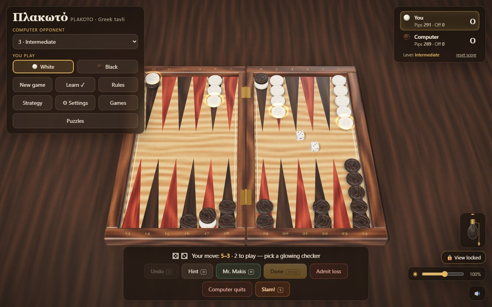

# Plakoto (Πλακωτό)

A photorealistic 3D game of **Plakoto**, the Greek pinning game of tavli (backgammon), played against the
computer. Five difficulty levels from Beginner to Expert, plus a level-10 coach, **Mr. Makis**, who plays
the best move he can find on your board and explains why.



- **Play in the browser:** <https://plakoto.vichos.org>
- **Android:** download `Plakoto-<version>.apk` from the [latest release](../../releases/latest) and open it
  on your phone (you will be asked to allow installing apps from your browser or file manager). It runs
  fully offline.
- Sister game: **Fevga** — <https://fevga.vichos.org>, [source](https://github.com/mvichosfm/fevga).

No accounts, no ads, no tracking, no network calls: the game is a static page and everything it remembers
(settings, scores, saved games) stays in your browser or on your phone.

## Features

- Five computer levels, each measured to beat the one below it in self-play (points share 96%, 86%, 76%,
  60%), from random play to a two-ply expectimax search. The evaluation was tuned by self-play.
- **Mr. Makis**, the coach: plays his move on your board, explains it from the position (pins made and
  released, the mother, lone checkers left open to a pin and their chance of being pinned, blocks) and
  shows the next two candidates with win estimates from play-outs. Measured against the Expert: 22 games
  to 18, 36 points to 23.
- **Mistake review**: after a game, Mr. Makis finds your costliest moves (every move scored two rolls
  deep, the doubtful ones played out to the end) and shows each one in replay: the position, your move,
  and his move as a what-if, with the win chance each one gives.
- **Puzzles**: 31 "find the best move" positions from computer games, each with an answer Mr. Makis proved
  by playing every candidate to the end hundreds of times. Graded Easy to Master by which computer level
  already finds the move.
- **Guided lessons** (the *Learn* button, and a welcome screen on the first visit): nine short scripted
  positions on the real board, one rule each: the two ways round, pinning, closed points, holding a pin,
  the larger die, doubles, the mother, bearing off past a pinned checker, mars.
- **Pins you can see:** a pinning checker sits on the pinned one, slightly off centre, so a crescent of the
  pinned colour always shows.
- **Phone layout:** in landscape the board comes first, with a drawer for everything else; drag a checker
  to move it.
- **Hint**, **Undo**, an optional **opening throw**, **match to 5**, **auto-end turn**, **winning chances**
  (including the chance of a tie), **Admit loss** / **Computer quits** as a single or double.
- **Game records:** the last five games kept automatically, up to ten named saves, move-by-move **replay**,
  **Continue from here**, and `.vbg` files to share a game (every move of an imported file is re-checked by
  the rules engine).
- Ten board styles (woods and marbles), a room dimmer, a retro lamp with a pull-chain switch, free or
  locked camera, point numbers, favourite setups you can save and export (`.vbs`).
- **Strategy guide** (English and Greek) built from 3,000 computer-vs-computer games: pins, the mother,
  lone checkers, how games end. Every figure is generated by `test/strategy-stats.mjs` and checked by
  `test/strategy-check.mjs`.
- And, for the bad days, **Slam!**: fold the board shut with a bang. The game carries on exactly where it was.

## Rules as implemented

From bkgm.com ("Plakoto") and Wikipedia ("Plakoto"):

- 15 checkers each, all starting on one point. The two sides travel in **opposite directions**: each
  side's starting point is the other side's last home point.
- **No hitting — pinning.** Landing on a point with a single opposing checker pins it: it cannot move
  until every checker of the pinner has left that point. A point is closed to you when the opponent has
  two or more checkers on it, or one checker pinning yours there. A point where you pin is yours.
- One checker playing both dice stops on the point between: it pins there if that point holds a lone
  checker, and frees it again by moving on.
- Play both dice if you can (four moves on doubles); if only one can be played, the larger.
- Bear off once all 15 are in your home board, exactly or with a higher die from your furthest-back
  point. A pinned checker of yours inside your home counts as home but cannot move (and still counts as
  furthest back); one pinned outside it stops bearing off.
- **The mother** — your last checker on your starting point. If it is pinned there you lose double at
  once, unless the pinner still has checkers on its own starting point; then play goes on and the pinner
  wins double the moment its own start is empty. If both mothers are pinned the game is a **tie**. Judged
  after every whole move.
- A win is 1 point; **mars** (the loser has borne off nothing) and a pinned mother are 2.

`src/engine.js` is the authority: its header lists the rules, and `test/rules.mjs` checks them with
hand-worked edge cases. `test/legality.mjs` re-implements the rules independently (absolute board,
brute force over every die order) and checks, for every roll in thousands of positions, that the moves
the game offers are exactly the legal ones, that every play the computer can choose replays click by
click through the same turn API the board uses, and that game results (mother, tie, mars) agree.
`PLAKOTO_ENGINE=<path>` points it at a modified engine: one-rule mutants (no anchors, pinned checkers
moving, no release, no waiver, no tie, ...) are all caught.

## Run it locally

The game has no build step. Serve the folder over HTTP (ES modules and the AI web worker do not load from
`file://`):

```bash
python serve.py          # http://127.0.0.1:8833, with caching disabled for development
```

## Tests

```bash
node test/rules.mjs                         # rules engine, edge cases, random full games, file formats (~4 s)
node test/legality.mjs                      # every legal play vs an independent brute-force rules implementation (~5 min)
node test/legality.mjs 12 200               # the same, a quick pass (~1 min)
node test/lessons.mjs                       # the guided lessons vs the engine (instant)
node test/strategy-check.mjs                # the strategy guide's figures re-measured, EN/EL parity (~30 s)
node test/selfplay.mjs 200 1-2 2-3 3-4 4-5  # each level against the one below
node test/makis.mjs 40 120                  # Mr. Makis against the Expert (slow: ~3 min a game)
node test/make-puzzles.mjs 8 10 150 40      # regenerate src/puzzles.js (worker threads, ~40 min)
node test/strategy-stats.mjs 3000 4         # the figures quoted in the strategy guide
```

`test/browser-harness.mjs` plays whole games through the page in a browser and checks the 3D board
against the engine after every turn (instructions in its header).

## Project layout

| Path | What |
|---|---|
| `index.html` | Page shell, HUD, sheets, styles; the import map points `three` at `vendor/`. |
| `src/engine.js` | Pure rules and AI (no DOM): legality with pins, the interactive turn API, full-turn enumeration, evaluation, the five levels and Mr. Makis's analysis. |
| `src/ai-worker.js` | Runs the computer's choice and Mr. Makis off the main thread. |
| `src/main.js` | Renderer, board and checker geometry (pinned stacks), animation, input, turn flow, HUD, settings. |
| `src/records.js` | Game records, move notation, `.vbg` / `.vbs` file formats with validated import. |
| `src/textures.js`, `src/themes.js` | Procedural wood and marble textures; the ten board styles. |
| `src/lessons.js` | The nine guided lessons as pure data: positions, rule text, goals and answers. |
| `src/puzzles.js` | The puzzles, generated by `test/make-puzzles.mjs`. |
| `src/effects.js` | Visual effects: the computer's last-move trails and the win confetti. |
| `src/sound.js` | Synthesised sounds (no audio files). |
| `strategy.html` | The strategy guide (standalone page, English and Greek). |
| `vendor/` | three.js r170 and three of its example modules (see `THIRD-PARTY-NOTICES.md`). |
| `app/` | Capacitor wrapper that packages the game as an Android app. |
| `test/` | Rules tests, the legality audit, self-play matches, the tuner, puzzles and the guide's statistics. |

## Build the Android app

Requirements: Node 18+, JDK 21 and the Android SDK (platform 35, build-tools 35).

```bash
cd app
npm install
node sync-web.mjs              # copies index.html, strategy.html, src/ and vendor/ into app/www
npx cap add android            # first time only; afterwards: npx cap sync android
node make-icons.mjs            # draws the launcher icons and splash into the Android project
node patch-android.mjs         # MainActivity: immersive landscape, keeps the phone's font size from scaling the HUD
cd android
./gradlew assembleDebug        # -> app/build/outputs/apk/debug/app-debug.apk
```

In the app the strategy guide opens as a full-screen sheet over the game, and file **exports** are not
available (Android's WebView does not download files); importing `.vbg` / `.vbs` files works.

## Licence

[MIT](LICENSE). three.js is MIT-licensed as well; see [THIRD-PARTY-NOTICES.md](THIRD-PARTY-NOTICES.md).
